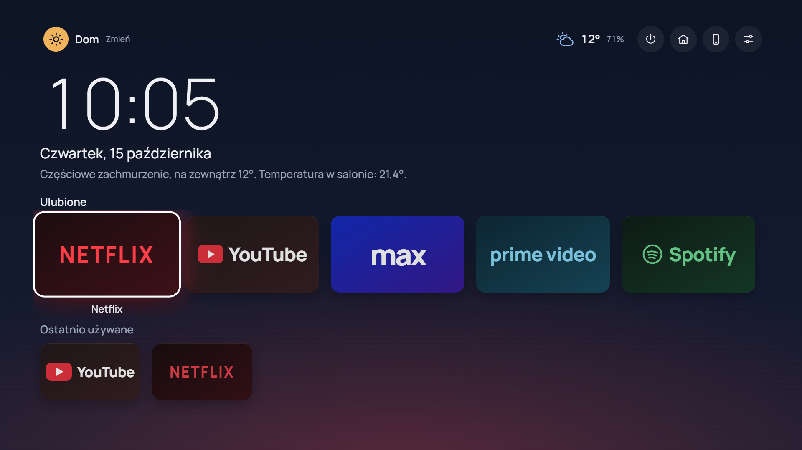
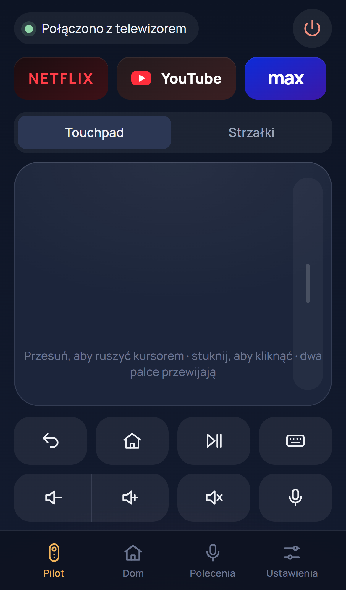

# Smart TV OS v3.0 — wspólny raport Codex + Claude

PR: **[HyziPyzi/HAOS-kiosk #1](https://github.com/HyziPyzi/HAOS-kiosk/pull/1)**,
branch integracyjny `feat/smart-tv-v3`, baza `main` **a8aa67b / 2.2.0**.
Wersja dodatku: **3.0.0**, slug pozostaje `haoskiosk_chrome`.
Nie wykonano merge do main ani wdrożenia na fizyczny HAOS.

## 1. Zakres Codex

Python/aiohttp: wspólne REST i WebSocket, parowanie PIN, hashowane sesje SQLite,
odwoływanie urządzeń, Origin/Host/CSRF, limity wejścia i połączeń, osobna aplikacja
HTTPS pilota bez starego wykonawcy komend. Integracja Core API Home Assistanta,
Panasonic, sterowanie istniejącym Chrome przez CDP i kursorem X przez stałe argv
xdotool, operacje one-click i Wieczór filmowy, parser polskich komend i opt-in
Assist text. Konfiguracja dodatku, Docker/CI, testy backendu i integracji,
dokumentacja bezpieczeństwa, HTTPS, aktualizacji i rollbacku.

## 2. Zakres Claude

Oryginalny launcher TV i pilot PWA: nawigacja strzałkami, focus, profile/awatary,
ulubione/kolejność/ostatnie, tapety/akcent/animacje/tryb nocny/safe area, pogoda
i wybrane encje HA. Pilot: touchpad, przewijanie, długie przytrzymanie, D-pad,
klawiatura, polskie komunikaty, aplikacje, TV/dom/komendy, parowanie, reconnect,
manifest/ikony/service worker/iOS safe areas. Lokalne fonty OFL, bez CDN ani
builda Node w produkcji. Mock kontraktu, Playwright i test Chrome/Openbox.

## 3. Screenshoty

To obrazy rzeczywiście uruchomionego UI w przeglądarce, z jawnymi danymi testowymi
HA i symulowanym telewizorem. Widok telefonu jest emulacją iPhone w Chromium,
nie zdjęciem fizycznego Safari ani dowodem działania DRM.

## 4. Weryfikacja

| Sprawdzenie | Wynik i granice |
|---|---|
| Backend v3 | 24 testy: rzeczywiste weryfikowane TLS/HTTP/WS i SQLite, jawne fixture HA/TV/CDP/X |
| Regresja lokalna | 33 testy łącznie: backend, polityki Chrome/uBOL, stary REST i ochrona launchera |
| Frontend lokalny | 25/25 Playwright: TV 1080p, iPhone, parowanie, gesty, profile, klawiatura PL/emoji, reconnect, błędy |
| Pełne testy Python w obrazie | 42/42: backend v3 oraz Chrome/X11, launcher/Openbox i regresje istniejących mechanizmów |
| Zależności developerskie | npm audit: 0 podatności po aktualizacji ws do 8.22.0 |
| Docker amd64 | Build i hadolint przeszły w GitHub Actions |
| Chrome/uBOL | Pełne CI zaliczone: instalacja Web Store, tryby/wyjątki, restart profilu, cookies i EME w wirtualnym X11 |
| Wspólna integracja | Test REST/WS → prawdziwy CDP/X11/Chrome zaliczony w CI; 10/10 kontroli UI → rzeczywisty backend zaliczone w harnessie |
| Sprzęt | Fizyczny NUC, HDMI/audio/DRM, Panasonic, Safari i pomiary CPU/RAM nie były dostępne |

Końcowa walidacja kodu **16c7c44**: **[CI PASS — backend, frontend i Docker/Chrome](https://github.com/HyziPyzi/HAOS-kiosk/actions/runs/38703468539)**.
Obraz amd64, hadolint, testy Chrome/X11/uBOL, schemat stabilnego Supervisora i
zgodność kopii dokumentacji przeszły. Szczegółowe komendy: [TESTING.md](../../TESTING.md). Wyniki CI i artefakty są
powiązane z konkretnymi commitami PR. Nie uznajemy obecności Widevine ani udanej
negocjacji EME za potwierdzenie odtwarzania Netflix/Max/Prime.

Kontrola UI z harnessa używała rzeczywistego API/sesji/cookies/WS/SQLite, z jawnymi
adapterami HA/CDP/X. Izolowany Chromium w tej kontroli akceptował jednorazowy
niezaufany certyfikat laboratoryjny — nie jest to test zaufania certyfikatu.
Zaufanie TLS sprawdzają osobno testy backendu. Produkcyjne Safari wymaga normalnej
weryfikacji i instalacji CA według instrukcji; WebKit/iOS nie były testowane.

## 5. Funkcje gotowe w implementacji

- Launcher i lokalne preferencje/profil, stały profil Chrome, nawigacja bez myszy,
  własne skróty i Ctrl+Alt+H, safe area bez zmiany xrandr.
- Pilot PWA z parowaniem, sesją HttpOnly, touchpadem i komendami, reconnect,
  odwołaniem telefonu oraz statyczną powłoką offline.
- Home Assistant/Panasonic, rzeczywiste stany i feature flags, operacje uruchamiania
  aplikacji i scena filmowa; brak encji TV nie blokuje samego otwierania aplikacji.
- Polski parser tekstu i opcjonalny fallback Assist text, bez obowiązkowych płatnych API.
- Istniejące Chrome Stable/Widevine/uBOL/GPU/audio/profil zachowane w obrazie i kodzie.

## 6. Co wymaga konfiguracji HA

Na TV wybierz `media_player` Panasonic, opcjonalne reklamowane źródło HDMI,
weather i wybrane encje light/switch/scene/script/sensor/climate. Scena filmowa
ma osobny wybór lamp/sceny/aplikacji/jasności i opcjonalnej głośności; nie dodaje
automatycznie osobnych kafelków tych lamp w telefonie. Identyfikatory nie są
hardcodowane. Konfiguracja HA jest edytowalna tylko przy lokalnym TV.

Assist wymaga skonfigurowanego lokalnego domyślnego agenta w HA i jawnego włączenia
na TV. Obowiązują uprawnienia encji wystawionych temu agentowi. Szczegóły:
[aktualizacja i HA](UPGRADE_ROLLBACK.md).

## 7. Testy akceptacyjne na NUC i iPhone

Sprawdź rzeczywisty film Netflix/Max/Prime, DRM/HDCP, Intel GPU i HDMI audio,
cookies po restarcie, USB HID i globalny powrót, kursor/scroll na VOD, Panasonic
on/off i timeout/HDMI/volume, iPhone Safari oraz dodanie do ekranu początkowego,
zaufany certyfikat bez ostrzeżeń, uśpienie/reconnect/revocation i dłuższą pracę
z HA. Zmierz CPU/RAM podczas odtwarzania i upewnij się, że HA pozostaje stabilny.
Wyłączenie TV nie wyłącza NUC-a ani Home Assistanta.

## 8. Aktualizacja dodatku

Po zatwierdzeniu wydania wykonaj i pobierz backup, zatrzymaj tylko kiosk, zachowaj
profil/opcje i prywatny obraz poprzedniego wydania. Zaktualizuj istniejący dodatek,
bez odinstalowania, zmiany slug i reinstalacji HAOS. Pilot HTTPS jest domyślnie
wyłączony. Szczegóły i lista kontroli: [UPGRADE_ROLLBACK.md](UPGRADE_ROLLBACK.md).

## 9. Parowanie telefonu

Po skonfigurowaniu HTTPS otwórz `/remote/` w Safari. Na TV wybierz Sparuj telefon,
wpisz jednorazowy PIN i nazwę telefonu. Kod jest ważny 120 sekund i ma limit prób.
Safari → Udostępnij → Do ekranu początkowego. Sesję można odwołać na TV; wygasa po
30 dniach. Nowa aplikacja standalone może wymagać ponownego parowania.

## 10. Bezpieczne HTTPS bez opłat

Stały adres LAN, własne lokalne CA, certyfikat serwera z poprawnym SAN, prywatny
klucz w konfiguracji dodatku, publiczny certyfikat CA zainstalowany i świadomie zaufany na
iPhone. Dokładny origin musi odpowiadać adresowi Safari. Nie pomijamy ostrzeżeń
ani weryfikacji certyfikatów; nie przekierowujemy portów routera.
Pełne polecenia OpenSSL, opcje iOS i odnowienie: **[HTTPS.md](HTTPS.md)**.

## 11. Powrót do poprzedniej wersji

Zatrzymaj tylko dodatek, przywróć wcześniejsze opcje i profil oraz prywatny obraz
2.2.0. Sam backup HA nie gwarantuje zachowania obrazu/dokładnej wersji Chrome.
Alternatywna odbudowa źródła `a8aa67b` może pobrać nowszy Chrome Stable. Starego
Chrome nie uruchamiaj z profilem zapisanym przez nowszą wersję. Zachowaj backupy
i istniejące tagi. Procedura: [UPGRADE_ROLLBACK.md](UPGRADE_ROLLBACK.md).

## 12. Ograniczenia

Bazowy głos to tekst i dyktowanie klawiatury iPhone, ewentualnie HA Assist text;
`audio_stt:false`, bez odbioru nagrania i ciężkiego silnika STT. Dostępność dyktowania
offline zależy od telefonu/języka. Prognoza pogody pozostaje pusta; bieżące warunki
pochodzą z HA. HDMI, volume i zasilanie zależą od realnych możliwości encji HA.
Konta i odtwarzanie VOD oraz natywne zachowanie stron wymagają sprawdzenia na NUC.
Pilot przeznaczony jest wyłącznie dla zaufanych domowników w prywatnym LAN.
Wibracje pilota działają tylko na wspierającym je Androidzie. Kody Wstecz/Home
pilota USB HID zależą od modelu; obsługiwane są Escape/BrowserBack/Backspace/Alt+←
oraz Home/BrowserHome. Czytelność z kilku metrów i płynność HD 520 wymagają NUC-a.

## 13. Wspólne decyzje i przegląd bezpieczeństwa

[API_CONTRACT.md](API_CONTRACT.md), [ARCHITECTURE.md](ARCHITECTURE.md),
[SECURITY_REVIEW.md](SECURITY_REVIEW.md). Praca odbywała się w osobnych worktrees;
konflikt kontraktu rozwiązano z zachowaniem uzgodnionego modelu uprawnień sceny.
Claude przejrzał backend, Codex frontend. Poprawiono dostęp do technicznych adresów
lokalnych, usuwanie domyślnego profilu, kolejki wejścia/klawiatury i zależność ws.
Ograniczenia modelu zaufania i DoS kodu PIN są jawnie opisane w przeglądzie.
